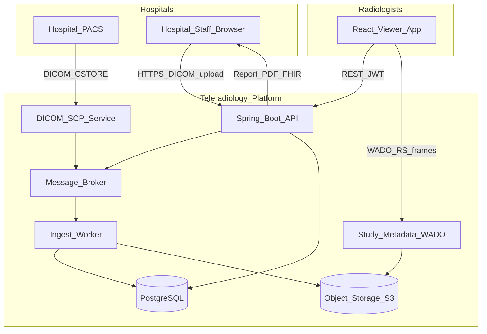
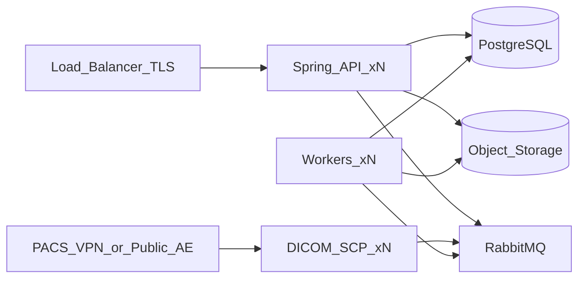

# Teleradiology Platform — Architecture & Delivery Plan

**Product requirements (source of truth):** [`docs/REQUIREMENTS.md`](docs/REQUIREMENTS.md) — scope, workflows, FRs, progress. This plan covers **architecture & how we build**; requirements own **what we commit to**.

**Stack:** Spring Boot (backend) · React (frontend)  
**Ingest:** Web DICOM upload **and** hospital PACS (DICOM network)  
**Goal:** Remote radiologists read studies, record interpretations, and return reports to hospitals — reducing delays caused by scarce on-site radiologists.

---

## 1. Problem & product goals

| Pain | System response |
|------|-----------------|
| Few radiologists, uneven coverage | Central worklist + assignment across hospitals |
| Studies wait for on-site readers | Remote secure viewer + async reporting |
| Reports hard to get back to sites | Structured reports delivered to hospital portal / FHIR / HL7 |
| Mixed ingest (USB, PACS, CDs) | Dual path: portal upload + DICOM C-STORE from PACS |

**Primary actors**

- **Hospital staff** — register patients/orders, upload or push studies, receive reports  
- **Radiologist** — claim/assigned worklist, view DICOM, dictate/type report, sign  
- **Admin** — tenants, users, AE titles, audit, SLAs  

---

## 2. Recommended MVP (phased)

### Phase 1 — Core loop (ship first)

1. Multi-tenant auth (hospital vs radiologist vs admin)  
2. Study ingest via **web DICOM upload** (.dcm / ZIP of series)  
3. Study worklist with status: `RECEIVED → READY → IN_PROGRESS → REPORTED → DELIVERED`  
4. Web DICOM viewer (window/level, zoom, pan, scroll stack, basic measurements)  
5. Interpretation editor (findings, impression, critical flag) + e-sign  
6. Hospital portal: download/view signed PDF + structured JSON report  

### Phase 2 — PACS connectivity

1. DICOM SCP (C-STORE) to receive studies from hospital PACS  
2. DICOM associations: AE Title, host, port, Calling/Called AE per hospital  
3. Optional C-FIND / C-MOVE for pull workflows later  
4. Report outbound: FHIR DiagnosticReport (preferred) and/or HL7 ORU^R01  

### Phase 3 — Operations & scale

1. Priority / STAT queue, auto-assign rules, SLA timers & notifications  
2. Voice-to-text / report templates by modality  
3. Peer review, addenda, critical-result acknowledgment  
4. High-availability storage, CDN for tiles, horizontal SCP workers  

---

## 3. High-level architecture



**Why this shape**

- **API** owns auth, worklist, reports, tenant config.  
- **DICOM SCP** is a separate process/service so PACS traffic does not block HTTP.  
- **Workers** parse DICOM, extract tags, store pixels, mark study READY.  
- **Object storage** holds raw DICOM + derived frames/thumbnails.  
- **PostgreSQL** holds tenants, users, studies, series, instances, reports, audit.

---

## 4. Backend (Spring Boot) design

### 4.1 Modules / packages

```
com.telerad
  ├── auth          # JWT, roles, hospital/radiologist membership
  ├── tenant        # hospitals, AE titles, branding
  ├── study         # Patient/Study/Series/Instance metadata + worklist
  ├── ingest        # upload API + async parse pipeline
  ├── dicom         # dcm4che SCP/SCU adapters, WADO-RS
  ├── report        # drafts, sign, PDF, delivery
  ├── notify        # email/SMS/webhook on STAT / report ready
  └── audit         # immutable access & mutation log
```

### 4.2 Key libraries

| Concern | Choice |
|---------|--------|
| DICOM toolkit | **dcm4che3** (Java-native; SCP/SCU, tags, transfers) |
| DB | PostgreSQL + Flyway + Spring Data JPA |
| Object storage | MinIO (dev) / S3 (prod) via AWS SDK |
| Async | Spring AMQP (RabbitMQ) or Kafka if high volume |
| Auth | Spring Security + JWT (refresh tokens); later OIDC |
| PDF reports | OpenHTMLtoPDF or Flying Saucer |
| API docs | springdoc-openapi |

### 4.3 Core domain model

```
Tenant (Hospital)
User (roles: ADMIN, HOSPITAL_USER, RADIOLOGIST)
DicomNode (aeTitle, host, port, hospitalId, direction IN/OUT)

Patient (tenant-scoped identifiers)
Study (studyInstanceUID, accession, modality, priority, status, assignedTo)
  Series (seriesInstanceUID, modality, description)
    Instance (sopInstanceUID, storageKey, rows/cols, frames)

Report (studyId, status DRAFT|SIGNED, findings, impression, critical, signedAt, signerId)
ReportDelivery (channel PORTAL|FHIR|HL7|EMAIL, status, payloadRef)
AuditEvent (...)
```

**Identity rule:** Prefer DICOM UIDs (`StudyInstanceUID`, etc.) as natural keys; generate internal UUIDs for APIs.

### 4.4 Ingest flows

**A. Web upload**

1. `POST /api/hospitals/{id}/studies/upload` (multipart ZIP or multiple `.dcm`)  
2. Store raw bytes to object storage under `tenant/studyUID/...`  
3. Enqueue `StudyIngested` job  
4. Worker uses dcm4che to read dataset → upsert Patient/Study/Series/Instance  
5. Generate thumbnail + optional JPEG preview frames for fast viewer start  
6. Status → `READY`; notify eligible radiologists  

**B. PACS C-STORE**

1. SCP listens (e.g. port 11112), validates Calling AE against tenant `DicomNode`  
2. On C-STORE success: same storage path + same ingest job as upload  
3. Association rejected if AE unknown or TLS/cert policy fails  

**Idempotency:** Same `SOPInstanceUID` → overwrite or ignore duplicate; study status does not regress from `REPORTED`.

### 4.5 Reporting & delivery APIs (illustrative)

| Method | Path | Purpose |
|--------|------|---------|
| GET | `/api/worklist` | Filtered studies for radiologist |
| POST | `/api/studies/{id}/claim` | Assign to current user |
| GET | `/api/studies/{id}` | Metadata + series list |
| GET | `/api/dicom/studies/{uid}/series/...` | WADO-RS / frames |
| PUT | `/api/studies/{id}/report` | Save draft |
| POST | `/api/studies/{id}/report/sign` | Sign & lock |
| GET | `/api/hospitals/{id}/reports` | Hospital inbox |
| GET | `/api/reports/{id}/pdf` | Signed PDF |

### 4.6 DICOM services (Phase 2 detail)

- **SCP:** C-ECHO, C-STORE (Required Transfer Syntaxes: Explicit VR Little Endian; add JPEG Lossless / JPEG-LS later)  
- **Security:** DICOM TLS where hospitals require it; IP allowlists per node  
- **Outbound (later):** C-STORE commit of secondary capture / SR; FHIR `DiagnosticReport` + `DocumentReference` for PDF  

---

## 5. Frontend (React) design

### 5.1 Apps / areas

1. **Hospital console** — upload studies, track status, read/download reports  
2. **Radiologist workstation** — worklist + DICOM viewer + report panel  
3. **Admin** — users, hospitals, AE titles, audit search  

Monorepo suggestion: Vite + React + TypeScript; shared UI kit; route by role after login.

### 5.2 Viewer approach

**Do not build a full PACS viewer from scratch in MVP.**

Recommended path:

1. Integrate a proven web viewer (e.g. **Cornerstone3D** / OHIF-style stack) talking to your **WADO-RS** endpoints.  
2. Spring Boot serves metadata + frame retrieval from object storage.  
3. MVP tools: stack scroll, W/L presets (CT soft tissue/lung/bone, XR), zoom/pan, length measurement, invert.  

Layout: left series thumbnails · center viewport · right report editor (split view).

### 5.3 UX states that matter

- Worklist badges: STAT, overdue SLA, unread critical  
- “Claim” vs auto-assign to avoid double-reading  
- Autosave report drafts every few seconds  
- Sign confirmation modal (irreversible without addendum)  

---

## 6. Security & compliance baseline

Treat images and reports as **protected health information**.

| Control | Implementation |
|---------|----------------|
| AuthN/Z | JWT + RBAC; tenant isolation on every query |
| Transport | HTTPS everywhere; DICOM TLS for PACS where required |
| Encryption at rest | S3 SSE / disk encryption; DB encryption optional |
| Audit | Who viewed which study, who signed, who downloaded |
| Retention | Configurable per tenant |
| Secrets | Vault / cloud secret manager; never in git |
| Hardening | Virus scan uploads, max size limits, rate limits |

Plan for HIPAA / local equivalents (access controls, BAAs with cloud vendors, breach process) even if certification is post-MVP.

---

## 7. Deployment topology



- Docker Compose for local: API, Postgres, MinIO, RabbitMQ, SCP, React.  
- Prod: Kubernetes or managed VMs; SCP exposed only via VPN or restricted firewall to hospital IPs.

---

## 8. Suggested repository layout

```
/
├── backend/                 # Spring Boot multi-module or single module
│   ├── api/
│   ├── dicom-scp/
│   └── worker/
├── frontend/                # React + Vite + TS
├── docker-compose.yml
├── docs/
│   └── PLAN.md              # this document (or root PLAN.md)
└── README.md
```

Split **api / dicom-scp / worker** early enough that PACS ingest can scale independently.

---

## 9. Delivery milestones (concrete)

| Milestone | Outcome | Approx. order |
|-----------|---------|---------------|
| M0 Skeleton | Spring Boot + React + Auth + Postgres + Compose | Week 1 |
| M1 Upload ingest | Upload DICOM → metadata in DB → storage | Week 2–3 |
| M2 Worklist + report | Claim, draft, sign, PDF, hospital inbox | Week 3–5 |
| M3 Viewer | Cornerstone3D + WADO-RS frame serve | Week 4–6 (parallel) |
| M4 PACS SCP | C-ECHO/C-STORE + AE registry → same pipeline | Week 6–8 |
| M5 Hardening | Audit, notifications, SLA, FHIR delivery | Week 8–10 |

Parallelize **M3 viewer** with **M2 reporting** once study metadata APIs exist.

---

## 10. Risks & mitigations

| Risk | Mitigation |
|------|------------|
| Huge studies (MRI multi-series) | Async ingest; progressive frame load; not loading all into RAM |
| Transfer syntax / compression variety | Normalize to Explicit LE on ingest or support common JPEG/J2K |
| Double reporting | Optimistic lock + claim ownership |
| PACS network/security | VPN + AE allowlist + DICOM TLS |
| Viewer complexity | Adopt Cornerstone3D; limit MVP tools |
| Multi-tenant leaks | Forced `tenant_id` in repositories + integration tests |

---

## 11. Success metrics

- Time from study READY → first open by radiologist  
- Time READY → SIGNED (by modality / STAT)  
- % studies delivered back within SLA  
- Ingest success rate (upload vs C-STORE)  
- Critical result acknowledgment rate  

---

## 12. Immediate next implementation steps

When implementation starts (after plan approval):

1. Bootstrap `backend` (Spring Boot 3, Java 21, Security, Flyway, study/report entities).  
2. Bootstrap `frontend` (Vite React TS, auth shell, hospital upload page, radiologist worklist shell).  
3. Docker Compose: Postgres, MinIO, RabbitMQ.  
4. Implement upload → worker → READY path with one sample CT series.  
5. Wire Cornerstone3D to a minimal WADO-RS frame endpoint.  
6. Add report sign + PDF.  
7. Add dcm4che SCP module sharing the same ingest queue.

---

## Decision record (locked for this plan)

- **Ingest:** Both portal DICOM upload and PACS C-STORE.  
- **Backend:** Spring Boot + dcm4che3.  
- **Frontend:** React + TypeScript; Cornerstone3D for viewing.  
- **DB / files:** PostgreSQL + S3-compatible object storage.  
- **MVP priority:** End-to-end loop (upload → view → report → hospital delivery), then harden PACS and FHIR/HL7 outbound.
