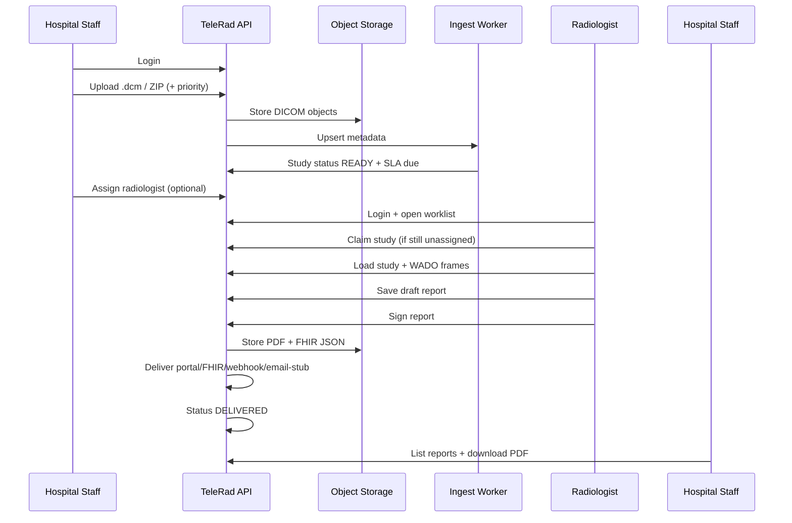

# TeleRad — Product Requirements (Source of Truth)

| Field | Value |
|-------|-------|
| **Product** | TeleRad |
| **Document** | Canonical product requirements |
| **Version** | 1.15 |
| **Date** | 2026-10-06 |
| **Owners** | Product + Engineering |
| **Status** | Active — **feature development (not live)** |
| **Related** | [`PLAN.md`](../PLAN.md) (architecture & delivery), [`README.md`](../README.md) (runbook), [`ETHIOPIA-GTM.md`](ETHIOPIA-GTM.md) (sales/GTM draft) |

This document defines **what** TeleRad must do. Engineering design lives in `PLAN.md`. UI visuals live in design tools. Sprint tasks live on the project board. **If a feature is not listed here (or is Deferred / Out of scope), it is not a current commitment.**

### Development posture (important)

TeleRad is in **feature development**. We are **not** in production / hospital go-live.

- Phases **P0 / P1 / P2** are **build order** for completing the product — not launch milestones.
- **No production go-live** until agreed in-scope features (P0–P2, minus Deferred) are finished and accepted.
- Where a feature depends on an **external system** (hospital PACS, SMS gateway, hospital webhook/EMR, email SMTP, etc.), we implement against a **simulator, stub, local stand-in, or sandbox** that behaves like the real device/service. Real vendor cutover is a later ops step after features are complete — it is **not** implied by finishing a phase.

---

## 0. Document control

### 0.1 How to change this document

1. Propose changes via PR (or explicit review).
2. Every new/changed FR must include: **ID · statement · priority · phase · status · acceptance**.
3. Open Decisions (§9) must be resolved before promoting Deferred FRs into Todo.
4. After implementation, update **Status** in the FR and the progress table (§8).

### 0.2 Status legend

| Status | Meaning |
|--------|---------|
| **Done** | Implemented and usable as described |
| **Partial** | Exists but missing acceptance criteria or edge cases |
| **Todo** | Agreed in scope; not built yet |
| **Deferred** | Parked — needs decision or later phase |
| **Out of scope** | Explicitly not part of this product version |

### 0.3 Priority legend

| Priority | Meaning |
|----------|---------|
| **P0 Must** | Core clinical loop; build first |
| **P1 Should** | Integrations & platform hardening in the build sequence |
| **P2 Could** | Clinical safety / ops enhancements |
| **P3 Won't (now)** | Explicitly deferred |

### 0.4 Phase legend (build order — not launch)

| Phase | Outcome |
|-------|---------|
| **P0 Core loop** | Upload → READY → (hospital assign or radiologist claim) → view → draft/sign → hospital PDF |
| **P1 Integrations & hardening** | PACS SCP, SLA/notify polish, FHIR/webhook delivery, admin completeness — **with simulated/stubbed externals as needed** |
| **P2 Clinical safety** | Indication gate, missing-images loop, critical acknowledgment, addenda |
| **Px Deferred products** | Billing, nurse triage, edge ingest, population health — only after OD sign-off |
| **Cutover (after features)** | Separate ops activity: point simulators to real PACS/SMS/webhook/SMTP. **Not a requirements phase.** |

---

## 1. Vision, goals & success metrics

### 1.1 Problem

Hospitals and imaging centers lack enough on-site radiologists. Studies wait, reports return slowly, and delivery back to the referring site is unreliable.

### 1.2 Product goals

1. Securely **ingest** DICOM studies from hospital staff (web upload) and, later, hospital PACS (C-STORE).
2. Provide a **central multi-tenant worklist** for remote radiologists.
3. Enable **web-based viewing** and **signed reporting**.
4. **Deliver** signed reports back to the hospital (portal PDF first; FHIR/webhook next).
5. Enforce **tenant isolation**, **audit**, and **SLA visibility**.

### 1.3 Success metrics

| Metric | Target (initial) |
|--------|------------------|
| Time READY → first radiologist open | Track; improve over baseline |
| Time READY → SIGNED (STAT) | ≤ SLA STAT minutes (tenant-configurable; default 60) |
| Time READY → SIGNED (ROUTINE) | ≤ SLA routine minutes (default 1440) |
| % studies delivered within SLA | ≥ 90% (measure in test/staging; apply in ops after cutover) |
| Ingest success rate (upload / C-STORE) | ≥ 99% of valid DICOM |
| Critical-flagged reports notified | 100% of signed critical reports emit notification events |

---

## 2. Scope

### 2.1 In scope (P0–P2)

- Multi-tenant auth with roles: Admin, Hospital Staff, Radiologist
- Portal DICOM upload (.dcm / ZIP)
- DICOM PACS C-STORE SCP with AE allowlist (P1)
- Study worklist, hospital assign (Dispatch & Triage), radiologist claim, priorities (STAT / URGENT / ROUTINE)
- Cornerstone-based viewer (W/L, zoom, pan, scroll, invert, length, cine)
- Draft + sign report → PDF + hospital inbox download
- Portal / stored FHIR JSON / webhook / email-stub delivery channels
- SLA deadlines + overdue detection + notification outbox
- Admin: tenants, users, DICOM nodes, audit, notification outbox
- Immutable audit for login, upload, claim, assign, sign, PDF download

### 2.2 Out of scope (this version)

- Full RIS/HIS replacement (scheduling, modality worklist MWL as primary order system)
- On-premise full PACS replacement
- Voice dictation / speech-to-text
- AI detection / CAD
- Native mobile diagnostic viewer (diagnostic reading is web)
- Storing raw card/CVV or acting as payment processor

### 2.3 Deferred product ideas (parked from prior draft)

Tracked so they are not lost. **Not commitments** until moved via Open Decision + FR status change.

| Idea | Notes | Gate |
|------|-------|------|
| Chapa / PATIENT_PAY billing gate | Payment before READY | OD-BIL |
| Nurse dispatch / assign role | Separate from Hospital Staff | OD-ROLE |
| Resident vs Senior sign split | Dual radiologist grades | OD-ROLE |
| Patient ephemeral mobile report link (SMS/WhatsApp) | Separate from facility image share (FR-SHARE); still deferred | OD-PAT / FR-DLV-008 |
| Edge Ingest Node | Offline/resumable clinic uploader | OD-EDGE |
| Population Health dashboard | Anonymized regional aggregates | OD-POP |
| Fatigue / reading-velocity alerts | Admin-only pace monitoring | OD-SAF |
| Smart hanging protocols (auto prior 1×2) | Prior fetch + sync scroll | OD-VW |
| HL7 v2 ORU^R01 outbound | Beyond current FHIR JSON/webhook | OD-INT |
| Report templates admin CRUD | Create/edit personal & global templates | FR-ADM-007 |

---

## 3. Actors & permissions

### 3.1 Roles (canonical)

| Role (UI) | Enum | Description |
|-----------|------|-------------|
| Admin | `ADMIN` | Platform operator; cross-tenant admin; may act as radiologist for claim/report |
| Hospital Staff | `HOSPITAL_USER` | Tenant-scoped; upload studies; assign to radiologists; view own hospital studies/reports |
| Radiologist | `RADIOLOGIST` | Read worklist; claim; view DICOM; draft/sign reports |

**Tenant-isolation rule:** A `HOSPITAL_USER` must only access data for their `tenantId`. Radiologists and Admins may see studies across tenants for reading/operations as designed. No user may access another tenant’s hospital portal data.

### 3.2 Permissions matrix

| Action | Hospital Staff | Radiologist | Admin |
|--------|:--------------:|:-----------:|:-----:|
| Login / logout | Allow | Allow | Allow |
| Upload DICOM for own hospital | Allow | Deny | Allow (any hospital) |
| View hospital studies/reports (own tenant) | Allow | Deny* | Allow |
| Assign study to a radiologist (own tenant) | Allow | Deny | Allow |
| View radiologist worklist | Deny | Allow | Allow |
| Claim study | Deny | Allow | Allow |
| Open diagnostic viewer | Deny | Allow | Allow |
| Non-diagnostic series preview (own tenant) | Allow† | Allow | Allow |
| Draft report | Deny | Allow | Allow |
| Sign report | Deny | Allow | Allow |
| Download signed PDF (own tenant / authorized) | Allow | Allow | Allow |
| Manage tenants / users / AE nodes | Deny | Deny | Allow |
| View audit / notification outbox | Deny | Deny | Allow |

\* Radiologists access studies via worklist/viewer, not the hospital staff portal.  
† Hospital Staff may load WADO thumbnails in Dispatch case detail for their own tenant. Diagnostic reading remains Radiologist/Admin.

### 3.3 Future roles (Deferred)

Nurse, Patient, Manager/Sales, Radiologist Resident/Senior — **not** in the permission matrix until OD-ROLE is resolved.

---

## 4. End-to-end workflows

### 4.1 Primary happy path (P0)



### 4.2 Workflow variants

| ID | Workflow | Summary | Phase |
|----|----------|---------|-------|
| WF-01 | Portal upload ingest | Staff uploads DICOM → parse → READY | P0 |
| WF-02 | PACS C-STORE ingest | Allowed AE C-STOREs → same pipeline → READY | P1 |
| WF-03 | Claim & read | Radiologist claims READY/IN_PROGRESS → viewer | P0 |
| WF-04 | Draft & sign | Draft findings/impression/critical → sign → PDF | P0 |
| WF-05 | Hospital delivery | Signed report in hospital inbox + PDF download | P0 |
| WF-06 | Outbound FHIR/webhook | Stored FHIR JSON + optional hospital webhook | P0/P1 |
| WF-07 | SLA breach | Overdue open study → mark breached → notify | P0/P1 |
| WF-08 | Critical flag notify | Signed with critical=true → elevated notify | P0 |
| WF-09 | Missing images loop | Request missing → hospital re-upload → return to reader | P2 Deferred |
| WF-10 | Critical ack chain | SMS/push ack with escalation timeout | P2 Deferred |
| WF-11 | Patient-pay gate | AWAITING_PAYMENT before READY | Px Deferred |
| WF-12 | Hospital assign | Staff/Admin assigns READY or IN_PROGRESS study to an active radiologist via Dispatch & Triage | P1 |

### 4.3 Critical safety workflows (target — P2)

1. **Critical result:** On sign with `critical=true`, notify hospital contact immediately; escalate if unacknowledged within configurable minutes; audit every attempt. *(Notify stub exists; ack chain is Deferred.)*
2. **Missing images:** Radiologist requests missing images; study flagged incomplete; hospital notified; on new ingest, study returns to original radiologist queue. *(Deferred.)*

---

## 5. Study lifecycle (state machine)

### 5.1 Canonical states

```
RECEIVED → READY → IN_PROGRESS → REPORTED → DELIVERED
```

| State | Meaning |
|-------|---------|
| `RECEIVED` | Objects arrived; metadata ingest in progress / not yet ready to read |
| `READY` | Study available on worklist; SLA clock started when first marked ready |
| `IN_PROGRESS` | Assigned or claimed; being reported by a radiologist |
| `REPORTED` | Report signed (transient around delivery pipeline) |
| `DELIVERED` | Delivery channels recorded; hospital can access signed report |

**Rule:** Status must **not regress** from `REPORTED` / `DELIVERED` when additional instances arrive (store instance; keep reported state).

### 5.2 Transitions & side effects

| From | Trigger | Actor | To | Side effects |
|------|---------|-------|-----|--------------|
| — | First successful ingest of study | System | `RECEIVED` then `READY` | Upsert Patient/Study/Series/Instance; set `readyAt`; apply `slaDueAt`; notify study ready |
| `READY` | Hospital assign | Hospital Staff/Admin | `IN_PROGRESS` | Set `assignedTo`, `claimedAt`; audit ASSIGN |
| `READY` | Claim | Radiologist/Admin | `IN_PROGRESS` | Set `assignedTo`, `claimedAt`; audit CLAIM |
| `READY` | Save draft report | Radiologist/Admin | `IN_PROGRESS` | Create/update draft; assign if unassigned |
| `IN_PROGRESS` | Hospital assign (reassign) | Hospital Staff/Admin | `IN_PROGRESS` | Update `assignedTo`, `claimedAt`; audit ASSIGN |
| `IN_PROGRESS` | Re-claim by same user | Radiologist/Admin | `IN_PROGRESS` | Refresh claim metadata |
| `IN_PROGRESS` | Sign (valid draft) | Radiologist/Admin | `REPORTED` → `DELIVERED` | Lock report; PDF; FHIR JSON; deliveries; notify; audit SIGN |
| Any open | SLA checker (due passed, not notified) | System | (status unchanged) | Set `slaBreachedAt`, `slaNotified`; notify SLA overdue |

### 5.3 Illegal / rejected transitions

| Attempt | Result |
|---------|--------|
| Hospital user claims | 403 |
| Claim when not READY/IN_PROGRESS | 409 |
| Claim IN_PROGRESS owned by another | 409 |
| Assign other-tenant study | 403 |
| Assign to inactive or non-radiologist user | 400 |
| Assign when not READY/IN_PROGRESS | 409 |
| Sign without impression | 400 |
| Sign already signed | 409 |
| Draft/sign when study already REPORTED/DELIVERED | 409 |
| Hospital user accesses other tenant | 403 |

### 5.4 Priorities

| Priority | Default SLA minutes (platform) | Tenant override |
|----------|--------------------------------|-----------------|
| `STAT` | 60 | `slaStatMinutes` |
| `URGENT` | 240 | `slaUrgentMinutes` |
| `ROUTINE` | 1440 | `slaRoutineMinutes` |

---

## 6. Functional requirements

> **FR format:** `FR-<GROUP>-<nnn>` — The system shall …  
> Fields: Priority · Phase · Status · Acceptance

### 6.1 Identity & access — `FR-AUTH`

| ID | Requirement | Pri | Phase | Status |
|----|-------------|-----|-------|--------|
| **FR-AUTH-001** | The system shall authenticate users with email + password and return a JWT access token plus role and tenant claims. | P0 | P0 | **Done** |
| **FR-AUTH-002** | The system shall reject invalid credentials and inactive users with 401 without issuing a token. | P0 | P0 | **Done** |
| **FR-AUTH-003** | The system shall expose a current-user endpoint (`/api/auth/me`) derived from the authenticated principal. | P0 | P0 | **Done** |
| **FR-AUTH-004** | The system shall enforce RBAC on API routes so each role only invokes allowed operations. | P0 | P0 | **Done** |
| **FR-AUTH-005** | The system shall isolate hospital-tenant data so `HOSPITAL_USER` cannot read/write other tenants. | P0 | P0 | **Done** |
| **FR-AUTH-006** | The frontend shall persist session client-side, restore on reload, and clear on logout. | P0 | P0 | **Done** |
| **FR-AUTH-007** | The frontend shall route users to role home (`/hospital`, `/worklist`, `/admin`) and guard routes by role. | P0 | P0 | **Done** |

**Acceptance (AUTH-001):** Valid login returns token + userId + role + tenant fields; audit LOGIN recorded.  
**Acceptance (AUTH-005):** Cross-tenant hospital study/report/upload attempts return 403.

---

### 6.2 Tenant & admin config — `FR-ADM`

| ID | Requirement | Pri | Phase | Status |
|----|-------------|-----|-------|--------|
| **FR-ADM-001** | Admin shall list and create tenants (code, name, active). | P0 | P0 | **Done** |
| **FR-ADM-002** | Admin shall list and create users with role and optional tenant. | P0 | P0 | **Done** |
| **FR-ADM-003** | Admin shall list and register DICOM nodes (AE title, host, port, direction, tenant). | P1 | P1 | **Done** |
| **FR-ADM-004** | Admin shall browse audit events. | P0 | P0 | **Done** |
| **FR-ADM-005** | Admin shall browse notification outbox events. | P1 | P1 | **Done** |
| **FR-ADM-006** | Admin shall configure per-tenant SLA minutes and notify email / webhook URL. | P1 | P1 | **Partial** |
| **FR-ADM-007** | Admin/Radiologist shall manage report templates by modality/body part. | P2 | Px | **Deferred** |

**Acceptance (ADM-003):** Node appears in registry and is usable for SCP allowlist checks.  
**Gap (ADM-006):** Fields exist on tenant model; admin UI/API for editing SLA/webhook may be incomplete — treat remaining UI as Todo within Partial.

---

### 6.3 Study ingest — `FR-ING`

| ID | Requirement | Pri | Phase | Status |
|----|-------------|-----|-------|--------|
| **FR-ING-001** | Hospital Staff (own tenant) or Admin shall upload one or more `.dcm` files via multipart form. | P0 | P0 | **Done** |
| **FR-ING-002** | The system shall accept a ZIP of DICOM files and extract processable entries. | P0 | P0 | **Done** |
| **FR-ING-003** | The system shall store raw DICOM bytes in object storage under a tenant/study/series/sop key. | P0 | P0 | **Done** |
| **FR-ING-004** | The system shall parse DICOM tags (patient, study, series, instance) and upsert Patient/Study/Series/Instance. | P0 | P0 | **Done** |
| **FR-ING-005** | After successful instance ingest (when not already reported), the study shall become `READY`, set `readyAt`, and apply SLA deadline. | P0 | P0 | **Done** |
| **FR-ING-006** | Upload may set study priority (`STAT` / `URGENT` / `ROUTINE`). | P0 | P0 | **Done** |
| **FR-ING-007** | Duplicate `SOPInstanceUID` shall update storage key without regressing REPORTED/DELIVERED status. | P0 | P0 | **Done** |
| **FR-ING-008** | Upload for another hospital by non-admin shall be rejected (403). | P0 | P0 | **Done** |
| **FR-ING-009** | Invalid DICOM shall be reported in the upload response `errors` list without failing the whole batch silently. | P0 | P0 | **Done** |
| **FR-ING-010** | Ingest shall publish/consume async messages for reprocessing resilience. | P1 | P1 | **Done** |

**Acceptance (ING-001–005):** Sample CT upload appears on radiologist worklist as READY with instance count ≥ 1.

---

### 6.4 PACS connectivity — `FR-PAC`

| ID | Requirement | Pri | Phase | Status |
|----|-------------|-----|-------|--------|
| **FR-PAC-001** | The system shall run a DICOM SCP supporting C-ECHO and C-STORE. | P1 | P1 | **Done** |
| **FR-PAC-002** | The SCP shall accept associations only from Calling AEs registered as active DICOM nodes for a tenant. | P1 | P1 | **Done** |
| **FR-PAC-003** | Successful C-STORE shall store objects and enter the same ingest pipeline as portal upload (`source=CSTORE`). | P1 | P1 | **Done** |
| **FR-PAC-004** | The SCP process shall be deployable separately from the HTTP API. | P1 | P1 | **Done** |
| **FR-PAC-005** | DICOM TLS and/or IP allowlisting per node shall be supported for hospital PACS links (develop/test with simulator or lab AE; real site config at cutover). | P1 | P1 | **Partial** |
| **FR-PAC-006** | Unsupported transfer syntaxes shall be rejected or transcoded per documented policy. | P2 | P1 | **Partial** |

**Acceptance (PAC-002–003):** Allowlisted AE stores instance → study READY; unknown AE rejected.

---

### 6.4b Secure edge delivery — `FR-EDGE`

Locked decisions (**2026-10-06**, supersede 2026-10-05 where they conflict). Radiologist worklist visibility remains **unchanged** (assigned-only is out of scope).

| ID | Decision |
|----|----------|
| **A1** | Path: Orthanc/agent → HTTPS ingest → **MinIO + worker** (not C-STORE hop into cloud SCP). |
| **B2** | Unmodified **Orthanc (Docker)** is the facility DICOM receiver; custom pynetdicom SCP is replaced. Agent keeps queue, uploader, audit; study readiness from Orthanc **changes feed** (persist cursor); delete from Orthanc after confirmed upload + safety period. |
| **C2** | One-time enrollment token obtains a **gateway client cert**. Bearer/token auth is **local-dev only**; **mTLS required before pilot**. |
| **D1** | Upload = **HTTPS multipart** (STOW-RS only if a partner requires DICOMweb). Per-instance results (success / duplicate / failed + temporary-or-permanent); confirm only after durable MinIO write; batched uploads with study-completeness handling. |
| **E3** | Delete safety period **configurable**; default **24h** (pilot); shorter allowed for lab/dev. |
| **F1** | Edge package = **Docker Compose** (Orthanc + agent): pinned images; only DICOM port on LAN; volumes on encrypted disk; restart policies + health checks; secrets outside compose; log rotation; Docker preinstalled on device/VM image. |
| **G1** | Cloud SCP **private only** (VPN/lab); AE+IP allowlist per facility; same ingest pipeline as gateway/portal; external scan verifies never public. |
| **H2** | Ops pack + **required** mTLS heartbeat (no PHI); TeleRad alerts on missed heartbeats; alert on oldest queued study age; include disk watermark, queue depth, Orthanc/agent health, cert expiry, TLS-inspection detection, last successful upload time. |
| **I2** | TeleRad ingest audit: gateway/facility, study/series/SOP UIDs, cert serial/fingerprint, source IP, request ID, per-instance outcome; append-only; access-controlled; defined retention; **no PHI beyond UIDs**. |
| **J1** | TeleRad **internal CA** issues/rotates gateway certs; revoke by serial on compromise. |
| **K3** | Orthanc sender allowlist: **local file is source of truth**; heartbeat reports allowlist + rejected senders (AE+IP) read-only; log config changes; validate on load. Remote push (K2) planned for later rollout. |
| **L2** | Many gateways per facility; each gateway bound to **exactly one** facility with its own cert; admin labels (name, location, primary/backup, status); facility from binding only; replacement = enroll new → verify → disable old. |
| **M1** | Platform admin only for enroll + re-enable; facility admins may **disable** their facility's gateways (emergency); single-use short-lived tokens; MFA for these roles; actions audit-logged. |
| **N1** | Cert lifetime **90 days**; auto-renew from day 60 with retries; new key on device each renewal; renew auth'd by current cert; disabled cannot renew; expired → re-enroll; heartbeat alerts at 21 and 7 days; renewals audit-logged. |
| **O3** | Ingest-audit retention configurable; default = study/report retention (**minimum 1 year**), pending compliance confirmation; automatic logged purge; legal-hold exemption. |
| **P2** | Heartbeat every **5 min** (configurable); missed alert after **15 min**; critical events immediate; jitter; recovery notify + dedupe; heartbeat failures never block uploads. |
| **Q2** | Enrollment token TTL **24 hours**, single-use. |

| ID | Requirement | Pri | Phase | Status |
|----|-------------|-----|-------|--------|
| **FR-EDGE-001** | Platform admin shall register a gateway for a facility (labels: name, location, primary/backup, status) and issue a single-use enrollment token (TTL 24h). Facility admins shall not enroll or re-enable; they may disable gateways for their facility only. MFA required; actions audit-logged. | P1 | P1 | **Partial** |
| **FR-EDGE-002** | Gateway shall enroll with the token and receive a client certificate from the TeleRad internal CA; private key generated on device. Token/Bearer auth is local-dev only; pilot path is mTLS. | P1 | P1 | **Done** |
| **FR-EDGE-003** | HTTPS multipart ingest (mTLS) shall accept DICOM from an active enrolled gateway, attribute the study to the gateway's bound facility only, confirm success only after durable MinIO write, return per-instance results (stored / duplicate / failed + temporary-or-permanent), support batched uploads with study-completeness handling, and run the existing ingest pipeline with `source=GATEWAY`. | P1 | P1 | **Done** |
| **FR-EDGE-004** | Duplicate SOPInstanceUID shall be reported as duplicate success without corrupting the study (idempotent). | P1 | P1 | **Done** |
| **FR-EDGE-005** | Disabled gateways shall be rejected immediately (ingest, renew, heartbeat auth as applicable). | P1 | P1 | **Done** |
| **FR-EDGE-006** | Edge stack shall use unmodified Orthanc (Docker) as DICOM receiver with sender allowlist (AE+IP); Orthanc HTTP/UI internal-only and password-protected. Agent shall consume Orthanc stable-study signals via changes feed (persist cursor), queue/upload with retry, and delete from Orthanc only after confirmed upload + configurable safety period (default 24h). | P1 | P1 | **Partial** |
| **FR-EDGE-007** | Edge agent audit log shall record receive/queue/upload/fail/delete using UIDs only (no patient name/MRN/DOB). | P1 | P1 | **Done** |
| **FR-EDGE-008** | TeleRad SCP shall remain private (VPN/lab), AE+IP allowlist per facility, same pipeline as gateway/portal; must not be public (verified by external scan). | P1 | P1 | **Partial** |
| **FR-EDGE-009** | Edge shall ship as Docker Compose (Orthanc + agent): pinned image versions; only DICOM port exposed to LAN; volumes on encrypted disk; restart policies + health checks; secrets outside compose; log rotation. | P1 | P1 | **Partial** |
| **FR-EDGE-010** | Agent shall send mTLS heartbeats (no PHI) on a configurable interval (default 5 min); TeleRad shall alert after missed window (default 15 min). Payload/alerts cover disk watermark, queue depth, oldest queued study age, Orthanc/agent health, cert expiry (21d/7d), TLS-inspection detection, last successful upload, allowlist snapshot, rejected senders (AE+IP). Critical events immediate; jitter; recovery + dedupe; heartbeat must not block uploads. | P1 | P1 | **Partial** |
| **FR-EDGE-011** | TeleRad shall keep append-only, access-controlled ingest audit (gateway/facility, UIDs, cert serial/fingerprint, source IP, request ID, per-instance outcome + reason). Retention configurable; default ≥1 year aligned with study/report retention pending compliance; logged purge; legal-hold exemption. No PHI beyond UIDs. | P1 | P1 | **Partial** |
| **FR-EDGE-012** | Client certs: 90-day lifetime; auto-renew from day 60 over mTLS with retries; new key per renewal on device; disabled gateways cannot renew; expired requires re-enroll; renewals audit-logged; revoke by serial on compromise. | P1 | P1 | **Partial** |
| **FR-EDGE-013** | Local Orthanc allowlist file is source of truth; validate on load; log config changes; report allowlist + rejected senders via heartbeat (read-only). Remote allowlist push is out of scope for pilot (planned later). | P1 | P1 | **Partial** |

**Acceptance:** Simulated modality → Orthanc → agent → mTLS multipart ingest → worklist READY (`source=GATEWAY`); unknown/disabled gateway rejected; duplicate SOP reported; offline queue drains after reconnect; heartbeat miss alerts; Orthanc delete only after confirm + safety period.

---

### 6.5 Worklist & assignment — `FR-WL`

| ID | Requirement | Pri | Phase | Status |
|----|-------------|-----|-------|--------|
| **FR-WL-001** | Radiologist/Admin shall retrieve a worklist of studies in `READY` and `IN_PROGRESS` (default). | P0 | P0 | **Done** |
| **FR-WL-002** | Worklist shall support filters for modality and priority. | P0 | P0 | **Done** |
| **FR-WL-003** | Radiologist/Admin shall claim a READY study (or own IN_PROGRESS), setting assignee and `IN_PROGRESS`. | P0 | P0 | **Done** |
| **FR-WL-004** | Claim by another radiologist on an already claimed IN_PROGRESS study shall fail with conflict. | P0 | P0 | **Done** |
| **FR-WL-005** | Hospital Staff shall list studies for their hospital ordered by newest first. | P0 | P0 | **Done** |
| **FR-WL-006** | Worklist items shall show patient, hospital, modality, accession, status, priority, instance count, SLA due/overdue. | P0 | P0 | **Done** |
| **FR-WL-007** | Auto-assign rules (round-robin / least-loaded) shall assign READY studies without manual claim. | P2 | P2 | **Todo** |
| **FR-WL-008** | Claiming shall be blocked if clinical indication is empty. | P2 | P2 | **Deferred** |
| **FR-WL-009** | Hospital Staff/Admin shall assign a READY (or IN_PROGRESS) study at their hospital to an active radiologist; study becomes `IN_PROGRESS` with audit ASSIGN. | P1 | P1 | **Done** |

**Acceptance (WL-003–004):** First claim 200; second different user 409; audit CLAIM.  
**Acceptance (WL-009):** Hospital user assigns READY study → 200, assignee set; other-tenant assign → 403; non-radiologist target → 400.  
**UX (WL-009):** Hospital Staff/Admin use **Dispatch & Triage** (`/dispatch`): Pending Assignment vs Assigned queues; choosing a radiologist POSTs `/api/studies/{id}/assign`. Row click opens a case panel (demographics, clinical notes, series preview). Payment request and reject-incomplete-study actions are **not** in product (see WF-11, FR-SAF-002 Deferred).

---

### 6.6 Viewer — `FR-VW`

| ID | Requirement | Pri | Phase | Status |
|----|-------------|-----|-------|--------|
| **FR-VW-001** | Radiologist/Admin shall open a study detail including series and instance metadata. | P0 | P0 | **Done** |
| **FR-VW-002** | The system shall serve DICOM frames via WADO-style HTTP endpoints for the web viewer. | P0 | P0 | **Done** |
| **FR-VW-003** | The viewer shall support window/level, zoom, pan, stack scroll, invert, rotate/flip, and length measurement. | P0 | P0 | **Done** |
| **FR-VW-004** | Multi-frame / cine playback shall be supported when frame timing metadata exists. | P0 | P0 | **Done** |
| **FR-VW-005** | Series navigation (select series / instance) shall be available in the study viewer. | P0 | P0 | **Done** |
| **FR-VW-006** | W/L presets (CT soft tissue / lung / bone, etc.) shall be one-click. | P1 | P1 | **Done** |
| **FR-VW-007** | Smart hanging protocol: auto-load prior same patient/body part in 1×2 sync scroll. | P3 | P1 | **Done** |
| **FR-VW-008** | The radiologist viewer shall be a dedicated image-only workspace (RadiAnt-style series rail + viewport); the report editor shall open in a separate browser tab. | P1 | P1 | **Done** |
| **FR-VW-009** | Multi-viewport layouts: user may switch 1×1 / 1×2 / 2×2; each pane shows a series from the current study; click selects the active pane; series rail loads into the active pane; toolbar/keys apply only to the active pane. Prior compare remains a 1×2 preset. | P1 | P1 | **Done** |
| **FR-VW-010** | Sync scroll shall link multi-viewport / prior panes by anatomical position (ImagePositionPatient along the stack normal, or SliceLocation). When plane tags are missing, fall back to proportional index. | P1 | P1 | **Done** |
| **FR-VW-011** | MPR: for volumetric CT/MR series the user may open linked axial / sagittal / coronal orthographic views from one volume, with crosshair linking (Link views) and series selection into the MPR volume. | P1 | P1 | **Done** |
| **FR-VW-012** | MPR 2×2 fourth pane: toggle MIP (thick slab centered on the linked crosshair) and VR (3D volume rendering orbiting the crosshair center); RadiAnt-style Axial \| Sagittal / Coronal \| 4th layout. | P1 | P1 | **Done** |
| **FR-VW-013** | Export menu: Current viewport → PNG/JPEG; Current layout → PNG; Current image / Series / Study → DICOM. Large DICOM exports run asynchronously with progress. DICOM export streams original stored objects (tenant/study/series/SOP hierarchy) without rewriting metadata, and is audited. | P1 | P1 | **Done** |
| **FR-VW-014** | Print preview: dedicated dialog showing patient/study header and the current layout panes; options for patient info, orientation HUD, measurements (as rendered), page size, and portrait/landscape; Cancel / Print. | P1 | P1 | **Done** |

**Acceptance (VW-002–003):** Opening a READY CT study renders first frame &lt; NFR frame budget under normal load. Zoom in/out/fit and rotate ±90°/flip are available as discrete toolbar buttons (and `+` / `-` / `0` / `[` / `]` keys), independent of the drag-tool selection; the HUD reports the current zoom percentage and rotation angle. Finished length measurements can be selected and removed with Delete/Backspace, right-click → Delete, or the contextual toolbar Delete control; Esc cancels an unfinished length draw.  
**Acceptance (VW-006):** Viewer toolbar shows modality presets as buttons (CT: Soft tissue, Lung, Bone, Brain); click applies W/L immediately.  
**Acceptance (VW-007):** `GET /api/studies/{id}/priors` returns the patient's earlier studies, same-modality first. Opening a study with a same-modality prior hangs it 1×2 (current left, prior right) with the interval shown ("3 months earlier"), the series rail split into Current and Prior sections, and Sync scroll on by default so stepping either stack drives the other proportionally. Body part is not captured at ingest, so modality is the matching proxy; the Compare picker lists every prior and can be set to Off.  
**Acceptance (VW-008):** Claim opens `/studies/:id` with no report editor on the page; the viewer Report link opens `/studies/:id/report` in a new browser tab where findings/impression/sign live.  
**Acceptance (VW-009):** Layout buttons switch 1×1 / 1×2 / 2×2 for the current study; panes auto-seed consecutive series; clicking a pane marks it active (highlight) and only that pane shows tools / receives shortcuts; clicking a series loads it into the active pane. With Compare on, layout is forced to 1×2 (current | prior) and layout buttons for other grids are disabled.  
**Acceptance (VW-010):** With Sync scroll on and two series that share orientation but differ in slice count/spacing, scrolling one pane jumps the other to the nearest ImagePositionPatient along the stack normal (not the same index fraction). US/cine or series without plane tags still sync by fraction.  
**Acceptance (VW-011):** An **MPR** control appears when the study has a volumetric CT/MR series (≥8 single-frame slices). Entering MPR shows linked Axial / Sagittal / Coronal orthographic views of one series; **Link views** enables crosshairs so a click/drag in one plane updates the others; the series rail loads eligible series into the MPR volume; exiting MPR restores the previous stack layout.  
**Acceptance (VW-012):** MPR uses a RadiAnt-style **2×2** grid (Axial, Sagittal, Coronal, 4th). The 4th pane defaults to **MIP** with selectable slab thickness and follows the linked crosshair center; the user may switch it to **VR** (CT presets Bone / Soft-Tissue / Lung) which orbits around that center via trackball rotate.  
**Acceptance (VW-013):** Viewer **Export** menu offers viewport PNG/JPEG, layout PNG, and DICOM for image/series/study. Series/study DICOM create a job (`POST /api/studies/{id}/export`) with pollable progress and a zip of original `.dcm` objects; download is audited.  
**Acceptance (VW-014):** **Print** opens a preview with patient/study header and current layout tiles; toggles control header/HUD; Print uses the selected page size and orientation.
---

### 6.7 Reporting — `FR-RPT`

| ID | Requirement | Pri | Phase | Status |
|----|-------------|-----|-------|--------|
| **FR-RPT-001** | Radiologist/Admin shall save a draft report (findings, impression, critical flag) for an editable study. | P0 | P0 | **Done** |
| **FR-RPT-002** | Signing shall require a non-blank impression and an existing draft. | P0 | P0 | **Done** |
| **FR-RPT-003** | Sign shall set report `SIGNED`, generate PDF to object storage, and advance study to REPORTED then DELIVERED. | P0 | P0 | **Done** |
| **FR-RPT-004** | Signed reports shall not be editable via draft save (conflict). | P0 | P0 | **Done** |
| **FR-RPT-005** | Only assignee (or Admin) may draft/sign a claimed study. | P0 | P0 | **Done** |
| **FR-RPT-006** | Critical flag shall be persisted and included in PDF and notifications when true. | P0 | P0 | **Done** |
| **FR-RPT-007** | Report draft shall autosave periodically in the UI with a visible saving indicator. | P1 | P1 | **Todo** |
| **FR-RPT-008** | Addendum workflow after sign (new version without deleting original). | P2 | P2 | **Todo** |
| **FR-RPT-009** | Radiologist shall insert a report template via type → modality → body part cascade; order placeholders auto-fill; remaining clinical tokens stay editable. | P1 | P1 | **Done** |

**Acceptance (RPT-002–003):** Sign without impression → 400; with impression → PDF downloadable; study DELIVERED.

---

### 6.8 Delivery — `FR-DLV`

| ID | Requirement | Pri | Phase | Status |
|----|-------------|-----|-------|--------|
| **FR-DLV-001** | On sign, the system shall record a PORTAL delivery referencing the PDF storage key. | P0 | P0 | **Done** |
| **FR-DLV-002** | Hospital Staff shall list signed reports for their hospital and download PDF. | P0 | P0 | **Done** |
| **FR-DLV-003** | On sign, the system shall store a FHIR DiagnosticReport JSON object in storage and record FHIR delivery. | P0 | P0 | **Done** |
| **FR-DLV-004** | On sign, the system shall POST FHIR JSON to the tenant webhook when configured (else mark failed/skipped with reason). | P1 | P1 | **Done** |
| **FR-DLV-005** | On sign, the system shall record an email-stub delivery to tenant notify email or platform fallback. | P1 | P1 | **Done** |
| **FR-DLV-006** | PDF download shall be authorized and audited. | P0 | P0 | **Done** |
| **FR-DLV-007** | HL7 v2 ORU^R01 outbound to hospital EMR. | P2 | Px | **Deferred** |
| **FR-DLV-008** | Patient ephemeral mobile report link (SMS/WhatsApp). | P3 | Px | **Deferred** |

**Acceptance (DLV-002):** Hospital user sees signed report and downloads non-empty PDF.

> **Note:** Facility-scoped patient **image** shares (CD replacement) are **FR-SHARE-*** — not FR-DLV-008 / OD-PAT. OD-PAT remains Deferred for ephemeral single-report SMS/WhatsApp links.

---

### 6.8b Patient image share (CD replacement) — `FR-SHARE`

Facility staff create a **study-scoped** share: one MAIN READY+ study plus **frozen prior study IDs** available at create time. Unregistered recipients unlock with a printed link + access code and use the same diagnostic viewer (share mode) until expiry or revoke.

| ID | Requirement | Pri | Phase | Status |
|----|-------------|-----|-------|--------|
| **FR-SHARE-001** | Hospital Staff (own tenant), Admin, and Radiologist may create a share for a study at the patient’s facility tenant with explicit consent confirmation. | P1 | P1 | **Done** |
| **FR-SHARE-002** | Share requires `studyId` (MAIN). At create, freeze MAIN + prior study UUIDs (same ranking as staff Compare; exclude RECEIVED). Later studies/priors require a new share. | P1 | P1 | **Done** |
| **FR-SHARE-003** | Defaults: expiry 60 days, include signed reports on, DICOM zip download off; overrides allowed on create. | P1 | P1 | **Done** |
| **FR-SHARE-004** | Create returns one-time plain link token URL and access code; store only hashes. Access code charset omits ambiguous characters. | P1 | P1 | **Done** |
| **FR-SHARE-005** | Staff may list shares for a patient/facility, revoke, and regenerate access code (invalidates prior code/session version). | P1 | P1 | **Done** |
| **FR-SHARE-006** | Public metadata endpoint exposes non-PHI only (facility name, expired/revoked/locked). Unlock with access code issues a share JWT valid until share expiry; regenerate/revoke/expiry ends access. | P1 | P1 | **Done** |
| **FR-SHARE-007** | Share session may view only frozen MAIN+PRIOR studies; WADO and exports enforce study ∈ snapshot server-side. Priors endpoint returns frozen priors only. | P1 | P1 | **Done** |
| **FR-SHARE-008** | Signed report PDF download only when includeReports; DICOM zip only when allowDicomDownload. | P1 | P1 | **Done** |
| **FR-SHARE-009** | Unlock lockout after repeated failures; IP rate limit; `X-Robots-Tag: noindex` on public share responses; opaque token in URL (no PHI). | P1 | P1 | **Done** |
| **FR-SHARE-010** | Audit SHARE_CREATE, SHARE_REVOKE, SHARE_REGEN_CODE, SHARE_UNLOCK_OK/FAIL, SHARE_VIEW_STUDY, SHARE_DOWNLOAD_PDF, SHARE_DOWNLOAD_DICOM (userId null for public; IP always). | P1 | P1 | **Done** |
| **FR-SHARE-011** | Staff UI: consent + create from study, print-friendly HTML slip (facility, QR, URL, code, expiry, study identity + frozen prior count, keep-private; no diagnosis), manage revoke/regen. | P1 | P1 | **Done** |
| **FR-SHARE-012** | Public UI `/s/:token` unlock → `/s/:token/studies/:id` reuses staff `StudyViewerPage` in share mode (viewer tools + prior compare; hide report editor/worklist/claim/share-create). | P1 | P1 | **Done** |

**Acceptance checklist**

- [ ] Hospital/radiologist creates share from a study with consent; slip prints study identity + prior count; unlock opens full viewer on MAIN study
- [ ] Frozen priors appear in Compare; a prior created after the share is not visible
- [ ] Wrong codes lock out; revoked/expired share rejects unlock and JWT
- [ ] Signed PDF / DICOM zip gated by flags; unsigned reports never downloadable
- [ ] Radiologist/admin can create for patient facility; hospital user cannot create for other tenants
- [ ] WADO for non-snapshot studyId rejected under share JWT

**Out of scope (v1):** SMS/WhatsApp delivery, server PDF slip, live-updating study/prior list, other-facility studies, draft reports, JPEG-only package.

---

### 6.9 Notifications — `FR-NTF`

| ID | Requirement | Pri | Phase | Status |
|----|-------------|-----|-------|--------|
| **FR-NTF-001** | When a study first becomes READY, notify eligible radiologists (email stub + optional webhook). | P0 | P0 | **Done** |
| **FR-NTF-002** | When a report is signed, notify hospital contact (email stub + optional webhook). | P0 | P0 | **Done** |
| **FR-NTF-003** | When critical=true on sign, emit an additional CRITICAL_RESULT notification. | P0 | P0 | **Done** |
| **FR-NTF-004** | When SLA is breached, notify radiologists and record the event. | P0 | P0 | **Done** |
| **FR-NTF-005** | Every notification attempt shall persist to the notification outbox with status SENT/FAILED/SKIPPED. | P0 | P0 | **Done** |
| **FR-NTF-006** | SMS/push provider integration with delivery receipts (implement against provider sandbox or local simulator until cutover). | P1 | P1 | **Todo** |
| **FR-NTF-007** | Critical result acknowledgment + timed escalation chain. | P2 | P2 | **Deferred** |

---

### 6.10 Audit & compliance — `FR-AUD`

| ID | Requirement | Pri | Phase | Status |
|----|-------------|-----|-------|--------|
| **FR-AUD-001** | The system shall record audit events for LOGIN, UPLOAD, CLAIM, ASSIGN, SIGN_REPORT, DOWNLOAD_PDF (minimum). | P0 | P0 | **Done** |
| **FR-AUD-002** | Audit events shall include tenant, user, action, entity type/id, detail, timestamp (and IP when available). | P0 | P0 | **Done** |
| **FR-AUD-003** | Admin shall query recent audit events. | P0 | P0 | **Done** |
| **FR-AUD-004** | Audit storage shall be append-oriented (no end-user delete/edit API). | P0 | P0 | **Done** |
| **FR-AUD-005** | Cryptographic verification / WORM audit store. | P2 | P2 | **Todo** |

---

### 6.11 Clinical safety (future) — `FR-SAF`

| ID | Requirement | Pri | Phase | Status |
|----|-------------|-----|-------|--------|
| **FR-SAF-001** | Block claim if clinical indication is empty. | P2 | P2 | **Deferred** |
| **FR-SAF-002** | Request Missing Images with hospital notify and auto-return to radiologist. | P2 | P2 | **Deferred** |
| **FR-SAF-003** | Critical finding acknowledgment workflow with escalation. | P2 | P2 | **Deferred** |
| **FR-SAF-004** | Fatigue / abnormal reading-velocity admin alerts. | P3 | Px | **Deferred** |

---

### 6.12 Billing (future) — `FR-BIL`

| ID | Requirement | Pri | Phase | Status |
|----|-------------|-----|-------|--------|
| **FR-BIL-001** | Tenant payment mode PATIENT_PAY \| HOSPITAL_BILLED. | P3 | Px | **Deferred** |
| **FR-BIL-002** | Chapa checkout + signed webhook + idempotent settle. | P3 | Px | **Deferred** |
| **FR-BIL-003** | STAT payment override with mandatory reason. | P3 | Px | **Deferred** |
| **FR-BIL-004** | Refunds with audit. | P3 | Px | **Deferred** |

*Do not implement until OD-BIL is signed off.*

---

### 6.13 Extensions (future) — `FR-EXT`

| ID | Requirement | Pri | Phase | Status |
|----|-------------|-----|-------|--------|
| **FR-EXT-001** | Edge ingest daemon with local queue + resumable upload. | P3 | Px | **Superseded** — see FR-EDGE-* (OD-EDGE = B) |
| **FR-EXT-002** | Population health anonymized heatmap dashboard. | P3 | Px | **Deferred** |
| **FR-EXT-003** | Manager revenue reconciliation CSV export. | P3 | Px | **Deferred** |

---

## 7. Non-functional requirements

| ID | Requirement | Pri | Phase | Status |
|----|-------------|-----|-------|--------|
| **NFR-001** | Upload-to-READY for a typical ~500MB study should complete within 5 minutes on the reference deployment. | P1 | P1 | **Todo** (measure) |
| **NFR-002** | First diagnostic frame via WADO should load within 2 seconds under normal load. | P0 | P0 | **Partial** |
| **NFR-003** | Worklist for ≤100 rows should render within 1.5 seconds. | P0 | P0 | **Partial** |
| **NFR-004** | Platform availability target 99.5%; SCP restartable independently of API. | P1 | P1 | **Partial** |
| **NFR-005** | Deployment target: API/UI over HTTPS; SCP not on public internet (VPN/allowlist). Required for cutover; not a reason to call a phase “go-live.” | P0 | P1 | **Todo** (ops) |
| **NFR-006** | PHI protected via authZ, tenant isolation, encryption in transit; encryption-at-rest via storage/DB controls. | P0 | P0 | **Partial** |
| **NFR-007** | Never store raw payment card data in TeleRad. | P0 | Px | **Done** (N/A — no payments) |
| **NFR-008** | Horizontal scale path for API, workers, SCP; object storage for DICOM blobs. | P1 | P1 | **Done** (architecture) |
| **NFR-009** | Automated unit tests for core backend services and frontend auth/API helpers; CI should run them. | P0 | P0 | **Partial** (tests exist; CI wiring Todo) |

---

## 8. Phased delivery & progress tracker

### 8.1 Phase mapping (build order)

| Phase | FR groups | Outcome |
|-------|-----------|---------|
| **P0 Core loop** | AUTH, ING, WL, VW, RPT, DLV (portal), AUD, NTF (stubs) | End-to-end clinical loop in dev/test |
| **P1 Integrations & hardening** | PAC, ADM polish, DLV webhook, NTF SMS (sandbox/sim), NFR ops prep | Full integrations working with simulators/stubs |
| **P2 Clinical safety** | SAF, RPT addendum, WL auto-assign | Safety & ops maturity in the product |
| **Px Deferred** | BIL, EXT, template admin CRUD | Separate product decisions |
| **Cutover** | — | Only after P0–P2 (non-Deferred) features accepted; switch simulators → real externals |

### 8.2 Progress snapshot (2026-08-12)

Counts exclude Deferred/Out of scope.

| Group | Done | Partial | Todo | Deferred |
|-------|------|---------|------|----------|
| FR-AUTH | 7 | 0 | 0 | 0 |
| FR-ADM | 5 | 1 | 0 | 1 |
| FR-ING | 10 | 0 | 0 | 0 |
| FR-PAC | 4 | 2 | 0 | 0 |
| FR-WL | 7 | 0 | 1 | 1 |
| FR-VW | 9 | 0 | 0 | 0 |
| FR-RPT | 7 | 0 | 2 | 0 |
| FR-DLV | 6 | 0 | 0 | 2 |
| FR-NTF | 5 | 0 | 1 | 1 |
| FR-AUD | 4 | 0 | 1 | 0 |
| FR-SAF | 0 | 0 | 0 | 4 |
| FR-BIL | 0 | 0 | 0 | 4 |
| FR-EXT | 0 | 0 | 0 | 3 |
| NFR | 2 | 4 | 3 | 0 |
| **Active total (ex-Deferred)** | **≈64 Done** | **≈7 Partial** | **≈8 Todo** | — |

> Update this table whenever FR statuses change. Use it in sprint reviews to answer: **what is done, what is partial, what remains.**

### 8.3 Recommended next remaining work (ordered)

1. **P1:** Harden PAC TLS/IP allowlist; document transfer-syntax policy (`FR-PAC-005/006`) — validate with DICOM simulator / lab AE.
2. **P1:** Complete tenant SLA/webhook admin editing UI (`FR-ADM-006`).
3. **P1:** Report autosave UX (`FR-RPT-007`).
4. **P1:** SMS provider integration via sandbox/simulator (`FR-NTF-006`); draft HTTPS/VPN cutover runbook (`NFR-005`) without treating it as launch.
5. **P0/P1:** CI pipeline running backend + frontend unit tests (`NFR-009`).
6. **P2:** Addendum (`FR-RPT-008`); auto-assign (`FR-WL-007`); then safety pack after OD-SAF.
7. **After features complete:** Cutover checklist (real PACS AE, real webhook, real SMS/SMTP) — outside phase naming.

---

## 9. Open decisions

Unresolved items **block** promoting related Deferred FRs.

| ID | Topic | Options | Owner | Blocks |
|----|-------|---------|-------|--------|
| **OD-BIL** | Is patient-pay (Chapa) part of TeleRad? | A) No — hospital billed only. B) Yes — gate READY on payment. C) Later phase only. | Product | FR-BIL-* |
| **OD-ROLE** | Extra roles (Nurse, Resident/Senior, Patient, Sales)? | A) Keep 3 roles. B) Add Nurse assign. C) Split radiologist grades. | Product / Medical | FR-WL assign UX, FR-RPT sign rules |
| **OD-SAF** | Which clinical safety pack for P2? | A) Indication gate only. B) + missing images. C) + critical ack chain. D) All. | Medical Director | FR-SAF-* |
| **OD-PAT** | Patient-facing **ephemeral report** links (SMS/WhatsApp)? | A) Out of scope. B) Ephemeral link post-sign. **Unchanged / Deferred** — distinct from facility image share (**FR-SHARE**, shipped). | Product | FR-DLV-008 |
| **OD-EDGE** | Edge ingest node for low bandwidth / secure facility delivery? | **Resolved B (2026-10-06 locks A1–Q2).** Facility C-STORE → **Orthanc + agent** → mTLS HTTPS multipart ingest → MinIO+worker (`source=GATEWAY`). Bearer enroll/dev only; mTLS before pilot. Private SCP VPN/lab only. See §6.4b decision table. Radiologist assigned-only visibility remains **out of this scope**. | Product / Eng | FR-EXT-001, FR-EDGE-* |
| **OD-POP** | Population health analytics? | A) Out of scope. B) After core features (P0–P2) complete. | Product | FR-EXT-002 |
| **OD-INT** | HL7 v2 vs FHIR-only outbound? | A) FHIR/webhook only. B) Add ORU^R01. | Eng / Hospital IT | FR-DLV-007 |
| **OD-RPT** | Report templates priority? | **Resolved B — insert cascade shipped (FR-RPT-009).** Admin CRUD remains Deferred (`FR-ADM-007`). | Radiologist lead | FR-ADM-007 |
| **OD-NAME** | External brand: TeleRad vs TelerIS vs UniRIS | A) TeleRad (this doc). B) Other — rename everywhere. | Product | Docs/UI copy |

---

## 10. Appendices

### Appendix A — Domain model (summary)

```
Tenant
User (role, tenant?)
DicomNode (tenant, aeTitle, host, port, direction)

Patient (tenant-scoped)
Study (tenant, patient?, UIDs, priority, status, assignee, SLA fields, source)
  Series
    Instance (storageKey, frames, cine metadata)

Report (study, DRAFT|SIGNED, findings, impression, critical, pdf key)
ReportDelivery (channel PORTAL|FHIR|WEBHOOK|EMAIL, status, payloadRef)
NotificationEvent (outbox)
AuditEvent
```

Natural keys: DICOM UIDs. API keys: UUIDs.

### Appendix B — Integrations

| Integration | Purpose | Status |
|-------------|---------|--------|
| DICOM C-STORE / C-ECHO (dcm4che) | PACS ingest (test with simulator / sample AE) | Done (P1 hardening Partial) |
| S3-compatible object storage | DICOM + PDF + FHIR JSON | Done |
| RabbitMQ | Ingest queue | Done |
| FHIR DiagnosticReport JSON + webhook POST | Outbound structured report (stub/test webhook OK) | Done (HL7 v2 Deferred) |
| Email | Stub logging + outbox | Done (SMTP provider later / cutover) |
| SMS/Push | Critical / SLA / ready | Todo (sandbox/simulator until cutover) |
| Chapa | Payments | Deferred |

### Appendix C — API index (core)

| Method | Path | Purpose | Roles |
|--------|------|---------|-------|
| POST | `/api/auth/login` | Login | Public |
| GET | `/api/auth/me` | Current user | Auth |
| POST | `/api/hospitals/{id}/studies/upload` | Upload DICOM | Hospital, Admin |
| GET | `/api/worklist` | Radiologist worklist | Rad, Admin |
| GET | `/api/hospitals/{id}/studies` | Hospital studies | Hospital, Admin |
| GET | `/api/studies/{id}` | Study detail | Authorized |
| GET | `/api/studies/{id}/priors` | Earlier studies for the same patient | Authorized |
| POST | `/api/studies/{id}/claim` | Claim | Rad, Admin |
| GET | `/api/radiologists` | Active radiologists + pending counts | Hospital, Admin |
| POST | `/api/studies/{id}/assign` | Assign to radiologist | Hospital, Admin |
| PUT | `/api/studies/{id}/report` | Draft | Rad, Admin |
| POST | `/api/studies/{id}/report/sign` | Sign | Rad, Admin |
| GET | `/api/studies/{id}/report` | Get report | Authorized |
| GET | `/api/hospitals/{id}/reports` | Hospital report inbox | Hospital, Admin |
| GET | `/api/reports/{id}/pdf` | Download PDF | Authorized |
| GET | `/api/dicom/...` | WADO metadata/frames | Authorized |
| GET/POST | `/api/admin/tenants` | Tenants | Admin |
| GET/POST | `/api/admin/users` | Users | Admin |
| GET/POST | `/api/admin/dicom-nodes` | AE registry | Admin |
| GET | `/api/admin/audit` | Audit | Admin |
| GET | `/api/admin/notifications` | Notify outbox | Admin |

OpenAPI: `/swagger-ui.html` on the API process.

### Appendix D — Risk register

| ID | Risk | Mitigation | Related |
|----|------|------------|---------|
| RISK-01 | Critical result not received by hospital | Notify on critical sign; escalate ack chain (P2) | FR-NTF-003, FR-SAF-003 |
| RISK-02 | Double reporting | Claim ownership + 409 conflict | FR-WL-004 |
| RISK-03 | Incomplete study read | Completeness checks + missing-images (P2) | FR-SAF-002 |
| RISK-04 | SLA silent breach | SLA due fields, overdue UI, breach notify | FR-WL-006, FR-NTF-004 |
| RISK-05 | PACS security exposure | SCP off public net; AE allowlist; TLS | FR-PAC-002, NFR-005 |
| RISK-06 | Large study / slow network | Async ingest; progressive frames; Edge Deferred | FR-ING-*, FR-EXT-001 |
| RISK-07 | Multi-tenant data leak | tenant_id checks + tests | FR-AUTH-005 |

### Appendix E — Glossary

| Term | Definition |
|------|------------|
| **AE Title** | DICOM Application Entity name identifying a node |
| **Accession Number** | Hospital order identifier for a study |
| **C-STORE** | DICOM operation to store an image/object to an SCP |
| **FHIR** | HL7 Fast Healthcare Interoperability Resources |
| **MRN** | Medical record number (tenant-scoped patient id) |
| **SLA** | Agreed turnaround time READY → reported |
| **STAT** | Highest clinical priority |
| **StudyInstanceUID** | DICOM unique study identifier |
| **WADO** | Web Access to DICOM Objects (HTTP frame/metadata access) |
| **Assign** | Hospital Staff/Admin sets `assignedTo` on a study (audit `ASSIGN`); study is `IN_PROGRESS` |
| **Claim** | Radiologist self-assigns a study from the worklist (audit `CLAIM`) |
| **Dispatch & Triage** | Hospital coordinator queue to assign studies; not a Nurse role (OD-ROLE still Deferred) |
| **Worklist** | Queue of studies available for radiologist reading |

### Appendix F — References

- Engineering plan: [`PLAN.md`](../PLAN.md)
- Runbook: [`README.md`](../README.md)
- Ethiopia selling points (draft, not FRs): [`ETHIOPIA-GTM.md`](ETHIOPIA-GTM.md)
- Prior PM draft: `TELERIS .docx.pdf` (UniRIS/TeleRIS v2.0) — **superseded by this document** for commitments
- OpenAPI: local `/swagger-ui.html`

---

## Document history

| Version | Date | Author | Summary |
|---------|------|--------|---------|
| 1.0 | 2026-08-12 | Engineering (SoT rewrite) | Rebuilt from PM draft + codebase. Locked 3 roles, 5 study states, granular FRs with Done/Partial/Todo/Deferred, deferred billing/nurse/edge/pop-health. |
| 1.1 | 2026-08-12 | Engineering | Clarified: not live. Renamed “P1 Go-live” → “P1 Integrations & hardening”. Phases = build order; externals via simulators/stubs until features complete; cutover is separate. |
| 1.3 | 2026-08-19 | Engineering | FR-VW-006 Done: one-click W/L preset buttons in the reporting viewer. |
| 1.4 | 2026-08-30 | Engineering | FR-VW-008 Done: split the reporting workspace — image-only viewer at `/studies/:id`, report editor at `/studies/:id/report` in its own browser tab. |
| 1.5 | 2026-08-30 | Engineering | FR-VW-003: added rotate/flip controls and discrete zoom in/out/fit buttons; mouse bindings are now rebuilt on every tool switch. |
| 1.6 | 2026-08-30 | Engineering | FR-VW-007 Done (promoted P3 → P1): prior comparison with auto-hung 1×2 layout and synchronized scrolling, backed by a new priors endpoint. |
| 1.7 | 2026-09-28 | Engineering | FR-VW-003: length measurements can be deleted (Delete/Backspace, right-click Delete, toolbar Delete) and Esc cancels an unfinished draw. |
| 1.8 | 2026-09-29 | Engineering | FR-VW-009 Done: multi-viewport layouts 1×1 / 1×2 / 2×2 with active pane and series-to-active loading; prior compare stays a 1×2 preset. |
| 1.9 | 2026-09-29 | Engineering | FR-VW-010 Done: sync scroll by ImagePositionPatient / SliceLocation with proportional-index fallback. |
| 1.10 | 2026-10-01 | Engineering | FR-VW-011 Done: MPR axial/sagittal/coronal orthographic views with crosshair Link views. |
| 1.11 | 2026-10-02 | Engineering | FR-VW-012 Done: RadiAnt 2×2 MPR with MIP/VR 4th pane linked to the crosshair center. |
| 1.12 | 2026-10-02 | Engineering | FR-VW-013/014 Done: Export menu (PNG/JPEG + async DICOM) and Print preview with layout options. |
| 1.13 | 2026-10-05 | Engineering | OD-EDGE = B; added FR-EDGE-001–008 for secure facility gateway delivery (multipart ingest, not public SCP). |
| 1.14 | 2026-10-06 | Engineering | OD-EDGE locks A1–Q2: Orthanc receiver + agent, mTLS-before-pilot, multipart ingest contract, Compose packaging, heartbeat/ops, PKI/audit/RBAC. Expanded FR-EDGE-001–013; statuses reset to Partial/Todo where prior Done no longer matches. |
| 1.15 | 2026-10-06 | Engineering | Implemented FR-EDGE stack: internal CA + enroll/renew, mTLS :8443, ingest audit + heartbeat miss alerts, Orthanc+agent compose, allowlist render. MFA and encrypted-disk ops remain site/runbook. |
| 1.16 | 2026-10-09 | Engineering | Added FR-SHARE-001–012 (patient image share / CD replacement). OD-PAT / FR-DLV-008 remain Deferred for ephemeral single-report SMS links. |
| 1.17 | 2026-10-10 | Engineering | FR-SHARE study-scoped: MAIN study + frozen priors; public UI reuses StudyViewerPage share mode. |

**End of TeleRad Requirements Source of Truth**
